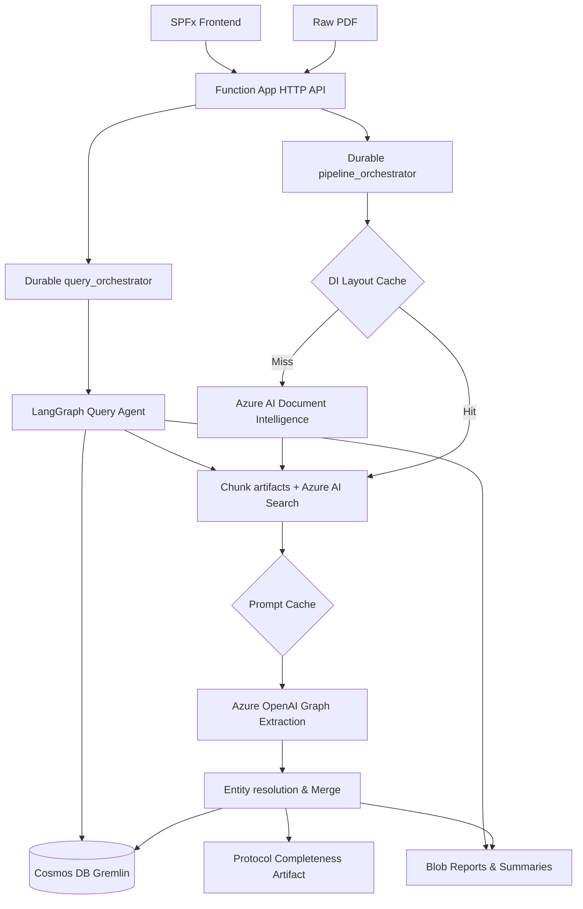

# MAG Agent

MAG Agent is a Hebrew investigative GraphRAG system for military and legal investigation files. It ingests raw PDFs, extracts a typed knowledge graph, stores searchable evidence artifacts, and exposes an agentic query engine that answers case questions using graph traversals and source text.

The system consists of three main operational surfaces:

- **Ingestion & Extraction Pipeline**: Azure Durable Functions map-reduce pipeline for PDF layout parsing, chunking, embedding generation, LLM graph extraction, entity resolution, community detection, report generation, and protocol completeness checks.
- **Case APIs**: HTTP endpoints for graph, timeline, report, community summaries, protocol completeness, pipeline status, on-demand agent verification, and query-agent execution.
- **SPFx Frontend**: SharePoint web part for case upload, pipeline tracking, interactive graph visualization (Cytoscape.js), report/timeline review, protocol completeness audit, and agent chat interface backed by client-side IndexedDB caching (`browserCache`).

---

## Architecture & Multi-Tier Caching



### Key Architectural & Optimization Pillars

1. **Multi-Tier Caching Pipeline**:
   - **Document Intelligence Layout Cache (`di_cache/{pdf_hash}.json`)**: Caches PDF page layout extraction using SHA-256 content hashes of raw PDF bytes, eliminating redundant layout API calls on re-runs.
   - **Azure OpenAI Prompt Caching**: Extraction prompts in `_build_prompt` are structured into a continuous **Static Prefix** (\(\ge 1,024\) tokens of ontology definitions, relation tables, and behavioral rules) and a **Dynamic Suffix** (pre-extracted regex findings, chunk context, raw text). Chunks 2..\(N\) hit the prompt cache, saving 50% on input token costs.
   - **Persistent Extraction Cache (`extraction_cache/`)**: Chunk extraction results are cached by `(model, schema_version, chunk_hash)` in Azure Blob Storage and retained across pipeline executions.
   - **Preserved Extracted Materials (`extracted/{doc_id}`)**: Unified Markdown text and chunk artifacts are preserved in storage for fast text retrieval and re-chunking.

2. **LangGraph Command-Based Query Agent**:
   - Built on a state-machine graph (`src/query_agent/nodes.py`) utilizing `Command(goto=...)` for dynamic routing between nodes: `hydrate` \(\rightarrow\) `coordinator` \(\rightarrow\) `doc_branch` / `graph_branch` \(\rightarrow\) `synthesis` \(\rightarrow\) `extraction` \(\rightarrow\) `halt_for_hitl` \(\rightarrow\) `planner` \(\rightarrow\) `finalizer`.
   - Includes **Human-In-The-Loop (HITL)** fact approval ledgers (`VerifiedFact`, `PendingFactApproval`) and **Recursion Limit Safeguards** (`remaining_steps <= 2`) that force graceful finalizer fallback.

3. **Protocol Completeness & Agent Verification**:
   - Analyzes case coverage against required investigative materials defined in `schemas/ontology_schema.json`.
   - Exposes `POST /api/cases/{docId}/completeness/verify` to asynchronously verify missing or ambiguous protocol items via background QueryAgent searches.

---

## Repository Map

```text
MAG_Agent/
├── function_app.py              # Azure Functions HTTP routes, Durable orchestrators, activities
├── schemas/ontology_schema.json # Extraction ontology + protocol completeness configuration
├── prompts/                     # Externalized system prompts and instruction templates
├── scripts/                     # Local/cloud runbooks, test suites, and backfill utilities
├── monitoring/                  # Azure Monitor / App Insights KQL snippets
├── frontend/mag-spfx/           # SharePoint Framework web part (React, Fluent UI, Cytoscape.js)
├── src/extraction/              # LLM extraction, prompt caching optimization, post-processing
├── src/graph/                   # Entity resolution, graph normalization, Cosmos DB Gremlin sync
├── src/models/                  # Pydantic DTOs, graph models, and ontology config models
├── src/processing/              # Pipeline activities, DI layout caching, chunking, indexing
├── src/query_agent/             # LangGraph state machine, nodes, HITL ledger, tool execution
├── src/reporting/               # Markdown report generator & protocol completeness analyzer
├── src/storage/                 # Blob/Azurite artifact store and Azure Search manager
└── src/utils/                   # Config, JSON repair, Hebrew helpers, observability
```

Each source module contains its own dedicated `README.md` for detailed technical orientation.

---

## Local Operations

### Prerequisites

Configure the required environment variables in `.env` or in the container runtime:

- `AZURE_OPENAI_API_KEY`, `AZURE_OPENAI_ENDPOINT`
- `AZURE_SEARCH_ENDPOINT`, `AZURE_SEARCH_KEY`
- `AZURE_DOCUMENT_INTELLIGENCE_ENDPOINT`, `AZURE_DOCUMENT_INTELLIGENCE_KEY`
- `COSMOS_GREMLIN_ENDPOINT`, `COSMOS_GREMLIN_KEY`
- `AZURE_STORAGE_CONNECTION_STRING`, `AzureWebJobsStorage`, or Azurite-compatible local storage settings

### Start the Stack

```bash
docker compose up --build
```

Health check:

```bash
curl -sS http://localhost:7071/api/health | jq
```

### Run Pipeline Locally

The local script restarts the Docker stack, runs dependency preflight, checks duplicate case status, uploads the PDF, polls the Durable instance, and prints the trace lookup key.

```bash
scripts/run_pipeline.sh
```

Override the PDF or trace ID:

```bash
PDF_PATH="data/my_case.pdf" TRACE_ID="pipeline-local-$(date +%s)" scripts/run_pipeline.sh
```

Cloud runner:

```bash
AZURE_FUNCTION_APP_URL="https://<app>.azurewebsites.net" \
AZURE_FUNCTION_APP_KEY="<function-key>" \
PDF_PATH="data/my_case.pdf" \
scripts/run_pipeline_cloud.sh
```

### Query Agent Test

```bash
TRACE_ID="query-test-$(date +%s)"
DOC_ID="<case-doc-id>"

START_RESPONSE=$(curl -sS -X POST "http://localhost:7071/api/query" \
  -H "Content-Type: application/json" \
  -H "x-mag-trace-id: ${TRACE_ID}" \
  --data-binary @- <<JSON
{
  "doc_id": "${DOC_ID}",
  "question": "מי החשודה המרכזית בתיק ומה מיוחס לה?"
}
JSON
)

echo "$START_RESPONSE" | jq
```

Poll the returned Durable instance:

```bash
INSTANCE_ID=$(echo "$START_RESPONSE" | jq -r '.id // empty')

curl -sS "http://localhost:7071/api/pipelines/${INSTANCE_ID}" \
  -H "x-mag-trace-id: ${TRACE_ID}" \
  | jq
```

---

## API Surface

Primary endpoints:

- `GET /api/ping`
- `GET /api/health`
- `GET /api/debug_logs` (enabled in local/dev or with `MAG_ENABLE_DEBUG_LOGS=true`)
- `POST /api/pipelines`
- `GET /api/pipeline-preflight?filename=<filename>`
- `GET /api/pipelines/{instanceId}`
- `POST /api/query`
- `GET /api/cases/{docId}/graph`
- `GET /api/cases/{docId}/timeline`
- `GET /api/cases/{docId}/report`
- `GET /api/cases/{docId}/communities`
- `GET /api/cases/{docId}/completeness`
- `POST /api/cases/{docId}/completeness/verify`

All pipeline and query requests send:

```http
x-mag-trace-id: <client-generated-trace-id>
```

---

## Observability

The Function App emits structured logs with the `[OBS]` prefix. Trace IDs correlate HTTP requests, Durable status, activity logs, metrics, frontend debug logs, and App Insights traces.

Detailed Azure Monitor / App Insights KQL examples are maintained in [monitoring/azure_monitor_observability.md](monitoring/azure_monitor_observability.md).

### Local Trace Lookup

Search recent local logs for a known trace or instance ID:

```bash
docker compose logs --tail=1000 function-app \
  | rg "\[OBS\].*(${TRACE_ID}|${INSTANCE_ID})" \
  | sed -E 's/^.*\[OBS\] //' \
  | jq
```

---

## Quality Checks

Backend quality check & unit tests:

```bash
.venv/bin/ruff check function_app.py src tests
PYTHONPATH=. ./.venv/bin/pytest -q
```

Frontend type check:

```bash
cd frontend/mag-spfx
./node_modules/.bin/tsc --noEmit
```
