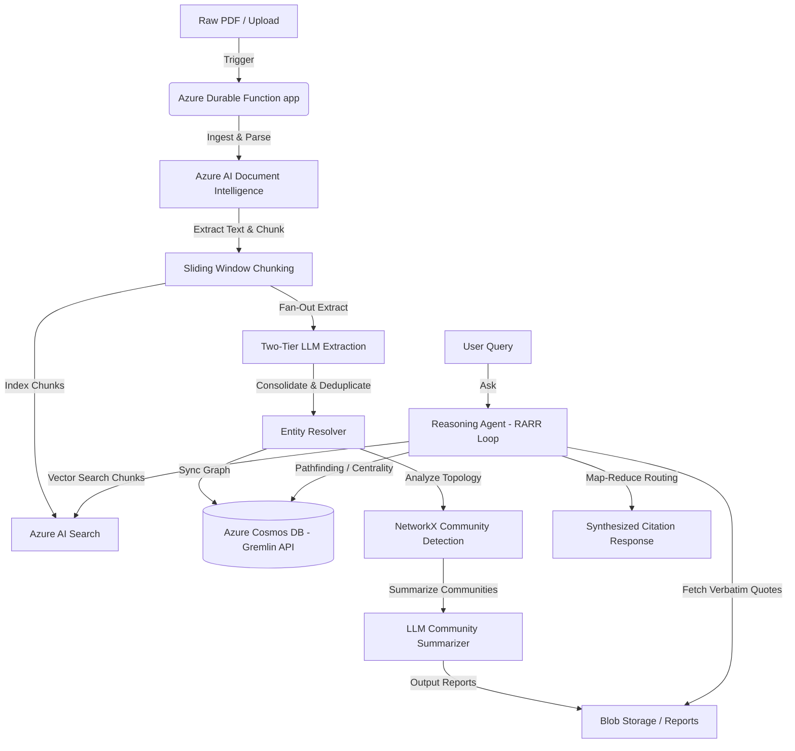

# MAG Agent (GraphRAG System for Hebrew Documents)

MAG Agent is a cloud-native, high-fidelity **Hybrid GraphRAG** (Graph Retrieval-Augmented Generation) system built for forensic and investigative analysis of Hebrew documents. It ingests files, extracts structured entities and relationships according to a strict legal/investigative ontology, resolves duplicates, builds a queryable property graph, and leverages an LLM reasoning agent to execute multi-hop pathfinding and grounded synthesis.

---

## 🌌 System Architecture

The project consists of two primary operational workloads: **Ingestion & Processing** (orchestrated by Azure Durable Functions) and **Querying & Reasoning** (orchestrated by the query agent).



### 1. Ingestion & Map-Reduce Pipeline
- **Orchestration**: Built on **Azure Durable Functions (Python V2 model)**, implementing a parallelized Map-Reduce workflow.
- **Parsing & Hebrew RTL Fixes**: Uses **Azure AI Document Intelligence** for layout-aware PDF text extraction, fixing RTL visual issues (reversed Hebrew characters).
- **Semantic Indexing**: Splits text into sentence-based overlapping chunks, generating embeddings with OpenAI models and uploading them to **Azure AI Search** (index: `graphify-chunks`).
- **Two-Tier Parallel Extraction**:
  - **Phase 1 (Raw Extraction)**: Employs `gpt-4o` with structural regex overrides (dates, amounts) to perform parallelized, sliding-window entity and relation extraction.
  - **Phase 2 (Post-Processing & Validation)**: Normalizes outputs against `ontology_schema.json` and generates context nodes (anchors) for co-occurrences.
- **Entity Resolution**: Resolves duplicate actors/locations via name-blocking, string similarities, and neighbor-based Jaccard scores. It deduplicates node aliases while archiving historical provenance inside Cosmos edge properties.
- **Unified Sync**: Automatically synchronizes the resolved network graph to **Azure Cosmos DB** (Gremlin API) with strict partition isolation using the document's ID (`doc_id`).
- **Community Summaries & Reporting**: Utilizes **NetworkX** to compute hierarchical community detection, generates LLM summaries for each cluster, and exports interactive Cytoscape HTML visualizations and Markdown summaries to Blob Storage.

### 2. Reasoning & Retrieval (Query Agent)
- **RARR Loop**: Uses a **Reasoning, Action, Retrieval, and Revision** execution pattern to draft answers, query sources, verify citations against raw text fragments, and revise responses to avoid hallucination.
- **Investigative Toolset**: Equipped with custom tools for deep graph analysis:
  - `global_graph_search`: Scans community summaries.
  - `find_connections`: Shortest-path traversals in Cosmos DB via Gremlin.
  - `search_semantic_actions`: Vector similarity search on relationship/edge labels.
  - `get_central_actors`: Degree centrality calculations to find primary actors.
  - `search_original_document`: Semantic chunk search in Azure AI Search.
  - `build_timeline`: Synthesizes chronological sequences of case occurrences.
  - `find_isolated_entities`: Searches for weakly connected actors relative to a seed node.
- **Map-Reduce Routing**: Automatically splits complex comparative queries (e.g. comparing actors across multiple events) into sub-queries, executes them in parallel, and merges findings.

---

## 📂 Project Structure

```bash
MAG_Agent/
├── .agents/                 # Workspace rules and specialized configurations
├── prompts/                 # System and user prompts for extraction & query routing
├── schemas/                 # Ontology and configurations for Pydantic models
├── scripts/                 # Utility scripts (test connections, cleanups, runs)
├── tests/                   # PyTest test cases for pipeline validation
└── src/                     # Core Python source code
    ├── models/              # Pydantic V2 schemas (Node, Edge, GraphExtraction)
    ├── interfaces/          # Blueprints and typing.Protocol definitions
    ├── processing/          # Ingestion, chunking, and Durable Function orchestration
    ├── extraction/          # Two-Tier LLM extraction and ontology normalizer
    ├── graph/               # Graph Manager, Cosmos Gremlin connector, Entity Resolver
    ├── query_agent/         # RARR reasoning engine, ontology rules, query tools
    ├── reporting/           # NetworkX community summaries & visualization reports
    ├── evaluation/          # Graph health metrics & RAG groundedness verifiers
    └── utils/               # JSON repairing, Bidi Hebrew support, config settings
```

---

## 🛠️ Getting Started & Local Operations

### Environment Configurations
Create a `.env` file in the root directory based on the environment variables defined in `.env` (or configure them directly in your container/host runtime):
- `AZURE_OPENAI_API_KEY` & `AZURE_OPENAI_ENDPOINT`: Access to LLM and embedding APIs.
- `COSMOS_GREMLIN_ENDPOINT` & `COSMOS_GREMLIN_KEY`: Access to Cosmos DB Graph database.
- `AZURE_STORAGE_CONNECTION_STRING` / `AzureWebJobsStorage`: Storage account connection.
- `AZURE_SEARCH_ENDPOINT` & `AZURE_SEARCH_KEY`: Access to Azure AI Search.
- `AZURE_DOCUMENT_INTELLIGENCE_ENDPOINT` & `AZURE_DOCUMENT_INTELLIGENCE_KEY`: Document processing key.

### Local Ingestion Stack (Docker Compose)
The repository includes a `docker-compose.yml` to spin up local development dependencies:
- **Azurite**: Emulates local Blob, Queue, and Table storage.
- **Function App Container**: Runs the local Azure Functions runtime environment.

Start the stack:
```bash
docker compose up --build
```

### Monitoring & Operations
- Check system health by querying the deep health check route:
  ```bash
  curl http://localhost:7071/api/health
  ```
- Send a document to the ingestion pipeline:
  ```bash
  curl -X POST --data-binary @path/to/doc.pdf -H "Content-Disposition: attachment; filename=doc.pdf" http://localhost:7071/api/pipelines
  ```
- View system logs, query databases, and manage storage containers using [CLOUD_OPERATIONS.md](file:///home/lior/projects/MAG_Agent/CLOUD_OPERATIONS.md).
- To deploy as a zip file to Azure App Service, follow [ZIP_DEPLOYMENT.md](file:///home/lior/projects/MAG_Agent/ZIP_DEPLOYMENT.md).
