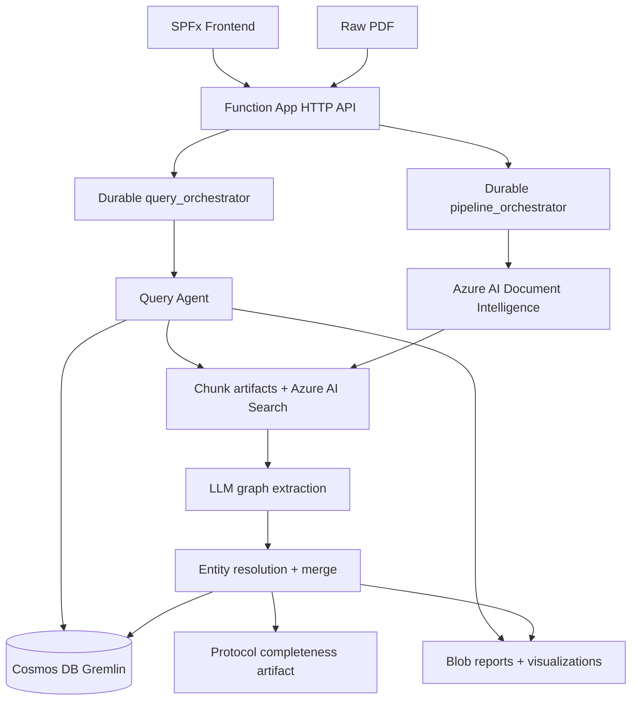

# MAG Agent

MAG Agent is a Hebrew investigative GraphRAG system for military/legal investigation files. It ingests raw PDFs, extracts a typed knowledge graph, stores searchable evidence artifacts, and exposes a query agent that answers case questions from graph and source material.

The current system has three main surfaces:

- **Ingestion pipeline**: Azure Durable Functions map-reduce pipeline for PDF parsing, chunking, graph extraction, merge, indexing, report generation, and protocol completeness checks.
- **Case APIs**: HTTP endpoints for graph, timeline, report, communities, protocol completeness, pipeline status, and query-agent execution.
- **SPFx frontend**: SharePoint web part for upload, pipeline tracking, graph/report/timeline review, protocol completeness review, and chat with the query agent.

---

## Architecture



Core data flow:

1. `POST /api/pipelines` receives a PDF and starts a Durable ingestion instance.
2. The pipeline writes chunks, raw text, partial graph artifacts, final graph JSON, reports, and `protocol_completeness.json`.
3. Final graph nodes/edges are synced to Cosmos DB Gremlin with strict per-case partitioning using `doc_id`/`pk`.
4. The frontend and query agent read the same case artifacts through HTTP APIs.

---

## Repository Map

```text
MAG_Agent/
├── function_app.py              # Azure Functions HTTP routes, Durable orchestrators, activities
├── schemas/ontology_schema.json # Extraction ontology + protocol completeness configuration
├── scripts/                     # Local/cloud runbooks and backfill utilities
├── monitoring/                  # Azure Monitor / App Insights KQL snippets
├── frontend/mag-spfx/           # SharePoint Framework web part
├── src/extraction/              # LLM extraction and post-processing
├── src/graph/                   # Entity resolution, graph normalization, Cosmos sync
├── src/models/                  # Pydantic DTOs and ontology config models
├── src/processing/              # Pipeline activities, chunking, indexing, cloud retrieval
├── src/query_agent/             # Query agent state, tools, LangGraph-style nodes
├── src/reporting/               # Markdown reports and protocol completeness analyzer
├── src/storage/                 # Blob/Azurite artifact store and Azure Search manager
└── src/utils/                   # Config, JSON repair, Hebrew helpers, observability
```

Each source module has its own README for implementation orientation.

---

## Local Operations

### Prerequisites

Configure the required environment variables in `.env` or in the container runtime:

- `AZURE_OPENAI_API_KEY`, `AZURE_OPENAI_ENDPOINT`
- `AZURE_SEARCH_ENDPOINT`, `AZURE_SEARCH_KEY`
- `AZURE_DOCUMENT_INTELLIGENCE_ENDPOINT`, `AZURE_DOCUMENT_INTELLIGENCE_KEY`
- `COSMOS_GREMLIN_ENDPOINT`, `COSMOS_GREMLIN_KEY`
- `AZURE_STORAGE_CONNECTION_STRING`, `AzureWebJobsStorage`, or Azurite-compatible local storage settings

### Start the Stack

```bash
docker compose up --build
```

Health check:

```bash
curl -sS http://localhost:7071/api/health | jq
```

### Run Pipeline Locally

The local script restarts the Docker stack, runs dependency preflight, checks duplicate case status, uploads the PDF, polls the Durable instance, and prints the trace lookup key.

```bash
scripts/run_pipeline.sh
```

Override the PDF or trace ID:

```bash
PDF_PATH="data/my_case.pdf" TRACE_ID="pipeline-local-$(date +%s)" scripts/run_pipeline.sh
```

Cloud runner:

```bash
AZURE_FUNCTION_APP_URL="https://<app>.azurewebsites.net" \
AZURE_FUNCTION_APP_KEY="<function-key>" \
PDF_PATH="data/my_case.pdf" \
scripts/run_pipeline_cloud.sh
```

### Query Agent Test

```bash
TRACE_ID="query-test-$(date +%s)"
DOC_ID="<case-doc-id>"

START_RESPONSE=$(curl -sS -X POST "http://localhost:7071/api/query" \
  -H "Content-Type: application/json" \
  -H "x-mag-trace-id: ${TRACE_ID}" \
  --data-binary @- <<JSON
{
  "doc_id": "${DOC_ID}",
  "question": "מי החשודה המרכזית בתיק ומה מיוחס לה?"
}
JSON
)

echo "$START_RESPONSE" | jq
```

Poll the returned Durable instance:

```bash
INSTANCE_ID=$(echo "$START_RESPONSE" | jq -r '.id // empty')

curl -sS "http://localhost:7071/api/pipelines/${INSTANCE_ID}" \
  -H "x-mag-trace-id: ${TRACE_ID}" \
  | jq
```

---

## API Surface

Primary local endpoints:

- `GET /api/ping`
- `GET /api/health`
- `GET /api/debug_logs` enabled only in local/dev or with `MAG_ENABLE_DEBUG_LOGS=true`
- `POST /api/pipelines`
- `GET /api/pipeline-preflight?filename=<filename>`
- `GET /api/pipelines/{instanceId}`
- `POST /api/query`
- `GET /api/cases/{docId}/graph`
- `GET /api/cases/{docId}/timeline`
- `GET /api/cases/{docId}/report`
- `GET /api/cases/{docId}/communities`
- `GET /api/cases/{docId}/completeness`

All pipeline and query requests should include:

```http
x-mag-trace-id: <client-generated-trace-id>
```

---

## Observability

The Function App emits structured logs with the `[OBS]` prefix. Trace IDs correlate HTTP requests, Durable status, activity logs, metrics, frontend debug logs, and App Insights traces.

Detailed Azure Monitor / App Insights KQL examples are maintained in [monitoring/azure_monitor_observability.md](monitoring/azure_monitor_observability.md).

### Local Trace Lookup

For a known Durable instance, fetch its status and read `customStatus.trace_id`:

```bash
INSTANCE_ID="<durable-instance-id>"

TRACE_ID=$(curl -sS "http://localhost:7071/api/pipelines/${INSTANCE_ID}" \
  -H "x-mag-trace-id: lookup-${INSTANCE_ID}" \
  | jq -r '.customStatus.trace_id // empty')

echo "$TRACE_ID"
```

Search recent local logs:

```bash
docker compose logs --tail=1000 function-app \
  | rg "${TRACE_ID}|${INSTANCE_ID}"
```

Pretty-print only structured observability logs:

```bash
docker compose logs --tail=1000 function-app \
  | rg "\[OBS\].*(${TRACE_ID}|${INSTANCE_ID})" \
  | sed -E 's/^.*\[OBS\] //' \
  | jq
```

### Query Agent Trace Lookup

Start a query with an explicit trace ID:

```bash
TRACE_ID="query-test-$(date +%s)"
DOC_ID="<case-doc-id>"

START_RESPONSE=$(curl -sS -X POST "http://localhost:7071/api/query" \
  -H "Content-Type: application/json" \
  -H "x-mag-trace-id: ${TRACE_ID}" \
  --data-binary @- <<JSON
{
  "doc_id": "${DOC_ID}",
  "question": "מי החשודה המרכזית בתיק ומה מיוחס לה?"
}
JSON
)

echo "$START_RESPONSE" | jq
INSTANCE_ID=$(echo "$START_RESPONSE" | jq -r '.id // empty')
```

Poll the query Durable instance:

```bash
curl -sS "http://localhost:7071/api/pipelines/${INSTANCE_ID}" \
  -H "x-mag-trace-id: lookup-${INSTANCE_ID}" \
  | jq
```

Trace the full query-agent execution. Use `TRACE_ID` for LangGraph events because only the outer Durable start event carries the Durable `INSTANCE_ID`:

```bash
docker compose logs --tail=1000 function-app \
  | rg "\[OBS\].*${TRACE_ID}" \
  | sed -E 's/^.*\[OBS\] //' \
  | jq
```

Show only LangGraph routing/tool events:

```bash
docker compose logs --tail=1000 function-app \
  | rg "\[OBS\].*query\.langgraph.*${TRACE_ID}" \
  | sed -E 's/^.*\[OBS\] //' \
  | jq
```

### Expected Pipeline Events

- `pipeline.started`
- `pipeline.orchestrator_started`
- `pipeline.chunking.completed`
- `pipeline.extraction.chunk_completed`
- `pipeline.merge.completed`
- `pipeline.final_indexing.completed`
- `pipeline.completed`
- `pipeline.failed`
- `protocol_completeness.generated`
- metric events such as `pipeline_start_count`, `pipeline_success_count`, `pipeline_failure_count`

### Expected Query Events

- `query.started`
- `query.orchestrator_started`
- `query.langgraph.node.started`
- `query.langgraph.plan.created`
- `query.langgraph.route.selected`
- `query.langgraph.doc_search.executed`
- `query.langgraph.graph_action.selected`
- `query.langgraph.synthesis.completed`
- `query.langgraph.extraction.completed`
- `query.langgraph.hitl.pending`
- `query.langgraph.hitl.processed`
- `query.langgraph.finalized`
- `query.completed`
- `query.failed`
- metric events such as `query_success_count`, `query_duration_ms`, `query_failure_count`

### App Insights Lookup

```kusto
let target_trace_id = "pipeline-or-query-trace-id";
traces
| where message has target_trace_id
| order by timestamp asc
```

Structured-only view:

```kusto
let target_trace_id = "pipeline-or-query-trace-id";
traces
| where message startswith "[OBS] "
| where message has target_trace_id
| extend obs = parse_json(substring(message, 6))
| project timestamp, event=tostring(obs.event), trace_id=tostring(obs.trace_id), doc_id=tostring(obs.doc_id), instance_id=tostring(obs.instance_id), obs
| order by timestamp asc
```

---

## Frontend

The SPFx web part lives in [frontend/mag-spfx](frontend/mag-spfx/README.md). It supports mock mode and live Function App mode. Live mode sends `x-mag-trace-id` for pipeline upload/preflight/status and query start/status calls.

```bash
cd frontend/mag-spfx
npm install
npm run trust-cert
npm run serve
```

---

## Quality Checks

Backend focused checks:

```bash
.venv/bin/ruff check function_app.py src tests
.venv/bin/python -m pytest -q
```

Frontend type check:

```bash
cd frontend/mag-spfx
./node_modules/.bin/tsc --noEmit
```
