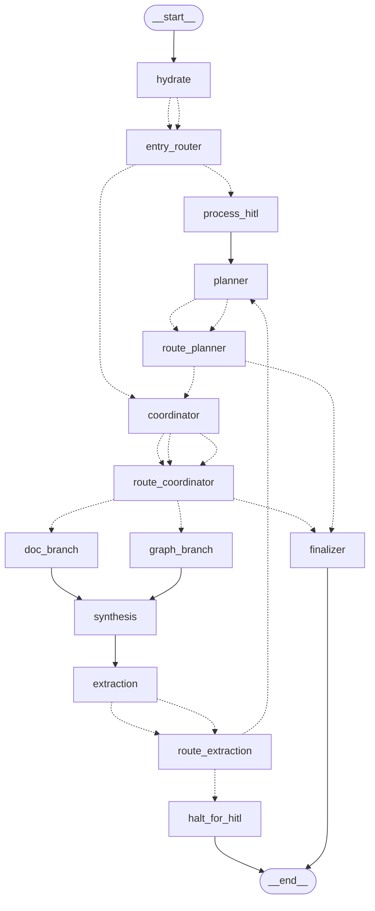
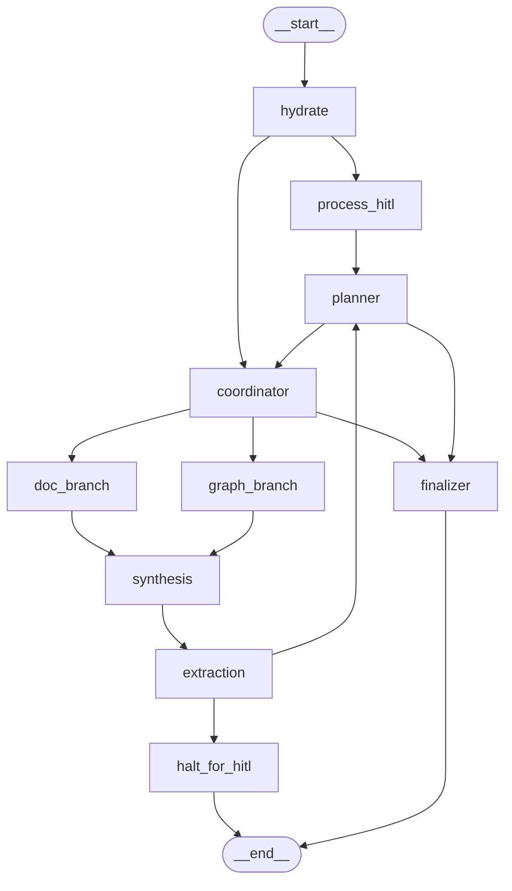

# Design Specification: LangGraph Optimizations (Hybrid Approach 3)

This design spec outlines how we will optimize our LangGraph state machine using modern dynamic routing via the `Command` API, while retaining `InvestigationState` as a Pydantic `BaseModel` for external API compatibility.

---

## 1. Goal & Context
Our current state machine in `src/query_agent/nodes.py` uses LangGraph's traditional `add_conditional_edges` and custom routing functions (`entry_router`, `route_coordinator`, `route_extraction`, `route_planner`).
Notably, `route_coordinator` executes an asynchronous LLM request to determine routing. Performing complex operations or async LLM requests inside edge routing functions is a LangGraph anti-pattern; LLM reasoning belongs in Nodes.

Using the `Command` API, we will:
1. Merge the routing decisions directly into the nodes (`hydrate`, `coordinator`, `extraction`, `planner`).
2. Return `Command` objects from these nodes that contain both the state updates and the dynamic `goto` instructions.
3. Remove all conditional edges, simplifying the graph definition.
4. Keep the Pydantic `BaseModel` schema `InvestigationState` for compatibility with existing client invocation loops in `src/query_agent/query_agent.py` and unit tests.

---

## 2. Proposed System Design

### Graph Topology Comparison

#### Current Topology (Conditional Edges):


#### Optimized Topology (Command-based dynamic routing):
All dashed lines (conditional edges) are eliminated. Nodes return a `Command` mapping their target destinations.


---

## 3. Detailed Dynamic Routing Changes

### A. `hydrate_node`
* **Current Signature**: `async def hydrate_node(state: InvestigationState) -> Dict[str, Any]`
* **Optimized Signature**: `async def hydrate_node(state: InvestigationState) -> Command[Literal["process_hitl", "coordinator"]]`
* **Routing Logic**:
  ```python
  goto = "coordinator"
  if state.pending_fact_approval is not None and state.user_feedback is not None:
      goto = "process_hitl"
  return Command(goto=goto)
  ```

### B. `coordinator_node`
* **Current Signature**: `async def coordinator_node(state: InvestigationState) -> Dict[str, Any]`
* **Optimized Signature**: `async def coordinator_node(state: InvestigationState) -> Command[Literal["doc_branch", "graph_branch", "finalizer"]]`
* **Routing Logic**:
  If no `current_task` and no tasks left in `investigation_plan`:
  ```python
  return Command(
      update={
          "investigation_plan": plan,
          "current_task": current_task,
          "messages": messages
      },
      goto="finalizer"
  )
  ```
  Otherwise, call the routing LLM to decide the route:
  ```python
  # Route decision
  decision = await call_llm(system_prompt, user_prompt)
  decision = decision.lower().strip()
  if "parallel" in decision:
      goto = ["doc_branch", "graph_branch"]
  elif "graph" in decision:
      goto = "graph_branch"
  else:
      goto = "doc_branch"
      
  return Command(
      update={
          "investigation_plan": plan,
          "current_task": current_task,
          "messages": messages
      },
      goto=goto
  )
  ```

### C. `extraction_node`
* **Current Signature**: `async def extraction_node(state: InvestigationState) -> Dict[str, Any]`
* **Optimized Signature**: `async def extraction_node(state: InvestigationState) -> Command[Literal["halt_for_hitl", "planner"]]`
* **Routing Logic**:
  ```python
  goto = "halt_for_hitl" if pending else "planner"
  return Command(
      update=updates,  # state updates
      goto=goto
  )
  ```

### D. `planner_node`
* **Current Signature**: `async def planner_node(state: InvestigationState) -> Dict[str, Any]`
* **Optimized Signature**: `async def planner_node(state: InvestigationState) -> Command[Literal["coordinator", "finalizer"]]`
* **Routing Logic**:
  ```python
  goto = "coordinator" if state.investigation_plan else "finalizer"
  return Command(goto=goto)
  ```

---

## 4. State Schema Integrity
We preserve the class `InvestigationState` from `src/query_agent/state.py` without modifications.
No changes are required in `src/query_agent/query_agent.py` since the return format of `ainvoke()` and graph state interaction remains identical.

---

## 5. Verification Plan

### Automated Tests
We will update `tests/test_langgraph_agent.py` to:
1. Mock and verify the `Command` return structure of the nodes rather than checking simple dictionaries.
2. Execute the entire test suite `pytest` to verify all integrations pass.

### Manual Verification
1. Run `visualize_graph.py` to ensure the generated graph structure correctly compiles and displays the new dynamic edges without errors.
