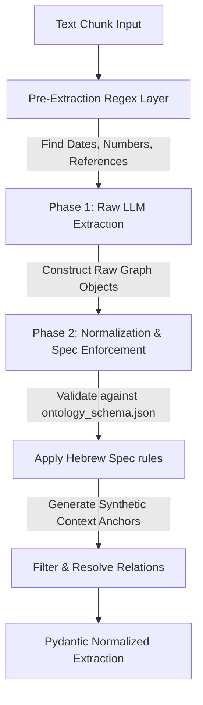

# Investigative Extraction Module (`src/extraction/`)

This module is responsible for transforming raw document chunks into structured graph components (nodes and edges) using a **Two-Tier LLM Ingestion Model**.

---

## 🏗️ Architecture: Two-Tier Extraction

The extraction process is executed in two distinct phases to enforce schema adherence, handle Hebrew language quirks, and capture context.

### 1. Phase 1: Raw Extraction (`extraction_engine.py`)
- **Ontology Mapping**: Extracts entities and relationships according to `ontology_schema.json`.
- **Regex Assistance**: Employs deterministic regex patterns to capture dates, monetary values, and source citations prior to sending prompts to the LLM.
- **Robust Cloud Connectivity**: Handles connection retries, custom timeouts, and DNS ip-lookup overrides to resolve cloud endpoints (e.g. Azure OpenAI endpoints) safely.
- **Caching**: Employs caching mechanism for extracted chunks to minimize LLM transaction costs and latency.

### 2. Phase 2: Normalization & Spec Enforcement (`post_processor.py`)
- **Hebrew Schema Mapping**: Maps free-form Hebrew relations and node attributes to formal schema identifiers (e.g. mapping `מנהל` to `MANAGES`).
- **Synthetic Context Anchors**: Generates co-occurrence context entities representing the specific document chunk where relationships occurred, linking entities together to prevent loss of situational context.
- **Confidence Scoring**: Assigns numeric confidence values based on evidence classifications:
  - `DIRECT_EVIDENCE` (high weight)
  - `CIRCUMSTANTIAL` (medium weight)
  - `AMBIGUOUS` (low weight)
- **Sanitization**: Filters low-confidence/noisy entities and resolves orphan properties.

---

## 📂 Key Components

- **`extraction_engine.py`**: The core extraction driver. Formulates system and user prompts (located in the root `/prompts` folder), manages tokens, builds the Azure OpenAI client, and calls `extract_from_chunk`.
- **`post_processor.py`**: Implementation of post-extraction normalizers, schema validations, Hebrew token translations, and metadata binding.
