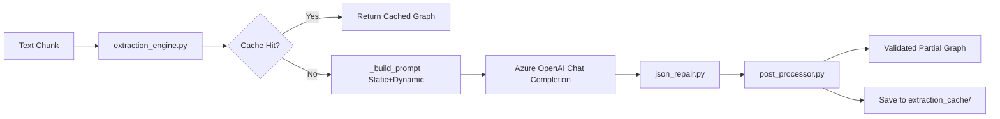

# Extraction Module

`src/extraction/` extracts schema-conformant knowledge graph nodes and edges from text chunks using Azure OpenAI LLMs and deterministic regex pre-extraction.

## Responsibilities

- Build extraction prompts optimized for Azure OpenAI Prompt Caching.
- Perform chunk-level graph extraction with fallback temperatures and automatic retries.
- Execute deterministic pre-extraction (dates, monetary amounts, legal references) to assist LLM extraction.
- Repair and parse malformed JSON outputs safely (`json_repair.py`).
- Normalize entities, relations, and confidence levels against `schemas/ontology_schema.json`.
- Bind source provenance (`source_file`, `source_location`) to every node and edge.
- Account for token consumption, including prompt cache hits (`cached_tokens`).

## Components

- `extraction_engine.py`: Prompt construction (`_build_prompt`), Azure OpenAI client setup (`_build_azure_client`), chunk extraction (`extract_from_chunk`), multi-tier caching, retry mechanisms, and token usage accounting (`_response_token_usage`).
- `post_processor.py`: Schema normalization, Hebrew relation translation, confidence level validation, synthetic node anchoring, provenance binding, and low-quality entity filtering.

## Prompt Caching & Structure Optimization

To leverage Azure OpenAI's automatic **Prompt Caching** (50% input token discount on matching prompt prefixes \(\ge 1,024\) tokens):

Prompt construction in `_build_prompt` is strictly partitioned into:

1. **Static Prefix** (\(\ge 2,200\) tokens):
   - Base Extraction Template
   - `### ENTITY TYPES DEFINITIONS` Table
   - `### RELATION TYPES DEFINITIONS` Table
   - `### CONFIDENCE LEVELS DEFINITIONS` Table
   - Schema & JSON Format Instructions
   - Global Behavioral Constraints
2. **Dynamic Suffix**:
   - `PRE-EXTRACTED ENTITIES` (regex findings)
   - `CONTEXT: CHUNK WINDOW` (chunk label)
   - `TEXT:\n` (chunk text)

Because the **Static Prefix** is byte-for-byte identical across all chunks in a pipeline run, Azure OpenAI caches the prefix tokens starting from chunk 2, dramatically reducing token costs and extraction latency.

## Pipeline Architecture



## Token Usage Accounting

`_response_token_usage` returns:

```json
{
  "input_tokens": 2850,
  "output_tokens": 420,
  "cached_tokens": 2240,
  "total_tokens": 3270
}
```

## Maintainer Notes

- **Static Prefix Preservation**: Do not insert dynamic chunk-specific variables into the middle of `_build_prompt`; all dynamic content must remain at the end to maintain prompt cache hit rates.
- **Ontology Alignment**: All entity types, relation names, and confidence levels must match definitions in `schemas/ontology_schema.json`.
- **Provenance**: `source_file` (`doc_id`) and `source_location` (`chunk_label`) must be preserved on every node and edge.
