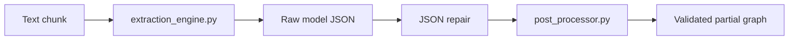

# Extraction Module

`src/extraction/` turns document chunks into schema-conformant graph nodes and edges.

## Responsibilities

- Build extraction prompts from the ontology and chunk context.
- Call Azure OpenAI for graph extraction.
- Repair and parse model JSON safely.
- Normalize extracted entities and relations against `schemas/ontology_schema.json`.
- Attach source provenance so downstream graph, reports, and completeness checks can explain where evidence came from.

## Current Components

- `extraction_engine.py`: prompt construction, Azure OpenAI client usage, chunk-level extraction, retry/error handling, and token accounting.
- `post_processor.py`: schema normalization, Hebrew relation mapping, confidence handling, synthetic anchors, source metadata binding, and low-quality item filtering.

## Pipeline Position

## Inputs And Outputs

Input:

- chunk text.
- chunk label/source location.
- ontology configuration.

Output:

- partial graph object with normalized `nodes`, `edges`, confidence, source file, source location, and metadata.

## Maintainer Notes

- Legal/domain extraction rules belong in `schemas/ontology_schema.json` and prompts, not hardcoded branches.
- Deterministic regex extraction should complement the LLM, not replace schema validation.
- Preserve source snippets and locations whenever available; auditability depends on them.
