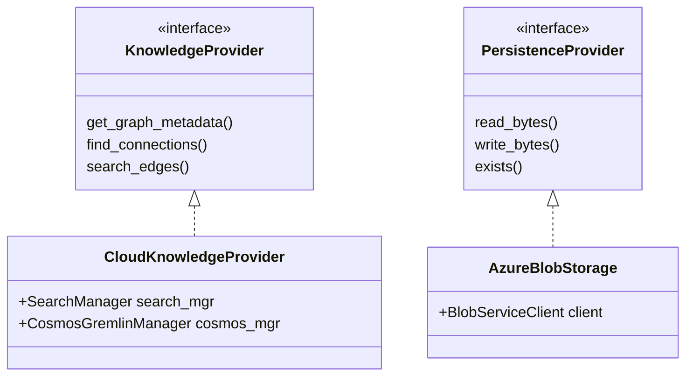

# Interfaces Module (`src/interfaces/`)

This module defines the core architectural contracts (using `typing.Protocol`) to guarantee loose coupling, mockability, and swappable components across the ingestion and query workloads.

---

## 🏗️ Core Protocols & Cloud Implementations

### 1. Data Ingestion & Storage Blueprints
- **`KnowledgeProvider`**: Standardizes retrievals of metadata, edges, and connections.
  - *Cloud Implementation*: `CloudKnowledgeProvider` in `src/processing/cloud_knowledge_provider.py` (lazily queries Azure Search and Cosmos DB).
- **`PersistenceProvider`**: Abstracts physical disk or cloud I/O.
  - *Cloud Implementation*: `AzureBlobStorage` in `src/storage/blob_storage.py` and `IArtifactStore` definitions.

### 2. Processing & NLP Blueprints
- **`ExtractionStrategy`**: Contract defining how document chunks translate to raw node/edge entities.
  - *Implementation*: `LLMExtractionStrategy` (invokes `extract_from_chunk`).
- **`EntityResolver`**: Contract defining how duplicate nodes are blocking-grouped and merged.
  - *Implementation*: `DefaultEntityResolver` (combines Edit Distance, Hebrew normalizations, and Jaccard neighbors).

### 3. Reporting & Metrics Blueprints
- **`VectorIndexer`**: Contract standardizing text embedding generations and vector client operations.
  - *Implementation*: `SearchManager` in `src/storage/search_manager.py`.
- **`Reporter`**: Standardizes the compilation of markdown/visual summaries.
  - *Implementation*: `DefaultReporter` inside `src/processing/strategies.py` delegating to `report_generator.py`.
