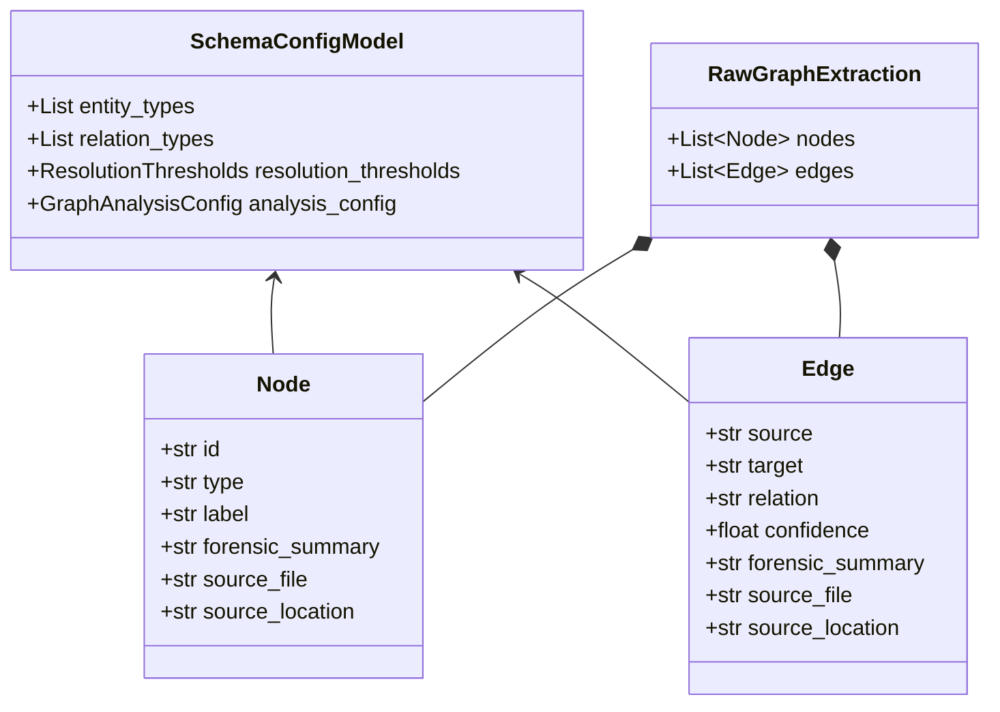

# Models Module (`src/models/`)

This module defines the foundational Data Transfer Objects (DTOs) and configuration models used across the ingestion pipeline and query reasoning engine, leveraging **Pydantic V2** to enforce type safety and runtime data validations.

---

## 🏗️ Schema Configuration & DTOs

The data model is driven dynamically by `schemas/ontology_schema.json` loaded during runtime:

### 1. Foundational Configurations (`base.py`)
- Defines the root `SchemaConfigModel` mapping legal, human, and organizational entity structures.
- Stores resolution thresholds (`ResolutionThresholds`) for the Jaccard similarity and string distance matching algorithms.
- Configures community detection settings (`GraphAnalysisConfig`), listing community summarization parameters and timeline regex formats.

### 2. Domain Models (`models.py`)
- **`Node`**: Validated entity schema. Captures node type, Hebrew labels, forensic descriptions, and document provenance references (`source_file`, `source_location`).
- **`Edge`**: Validated relationship schema. Contains source/target node identifiers, relationship type, confidence level, textual explanations, and source provenance references.
- **`RawGraphExtraction`**: Wrapper class used by the chunk extraction activities to represent intermediate partial graphs prior to merge.

---

## 🛠️ Data Normalization & Validation Logic

Pydantic validators (`@model_validator` and `@field_validator`) dynamically enforce several core constraints:
- **Hebrew Schema Translations**: Maps local/colloquial Hebrew relation inputs (e.g. `מנהל של`) to standardized uppercase relation keys (e.g. `MANAGES`).
- **epistemic filtering**: Identifies and flags relationships that fall below the schema confidence thresholds.
- **Provenance Injection**: Guarantees that every node and edge carries reference tags referencing the exact source file and chunk ID where it was identified.
- **Dynamic Constant Ingestion**: Derives and caches typing mappings, allowed entity labels, and default weights directly from the parsed `ontology_schema.json`.
