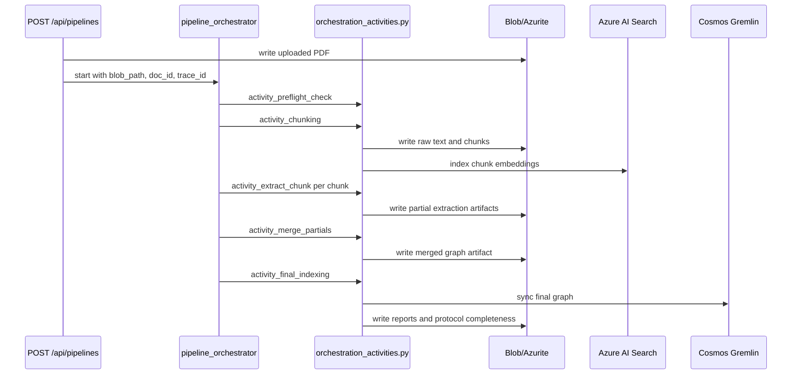

# Processing Module

`src/processing/` contains the ingestion pipeline activities and cloud retrieval/indexing adapters used by the Function App.

The Durable orchestrator itself is defined in `function_app.py`; the activity implementations live here.

## Responsibilities

- Parse PDFs with Azure AI Document Intelligence.
- Normalize Hebrew/right-to-left text and split documents into chunks.
- Generate embeddings and index chunks in Azure AI Search.
- Run chunk-level graph extraction.
- Merge partial graph outputs and run entity resolution.
- Generate final graph/report/protocol-completeness artifacts.
- Sync graph records to Cosmos DB Gremlin.
- Provide cloud-backed graph/source retrieval for the query agent.

## Current Components

- `document_processor.py`: PDF/Markdown parsing, DI integration, Hebrew cleanup, chunk generation.
- `orchestration_activities.py`: Durable activity implementations and pipeline observability events.
- `vector_indexer.py`: embedding generation and Azure AI Search indexing.
- `cloud_knowledge_provider.py`: Cosmos/Search-backed retrieval methods for the query agent.
- `persistence_manager.py`: artifact persistence coordination.
- `strategies.py`: strategy wrappers used by pipeline orchestration.

## Pipeline Flow

## Observability

Activities emit structured `[OBS]` logs and metrics for phase completion, failures, durations, protocol completeness, and LLM cost-control decisions. The trace ID is passed from the HTTP request into Durable input and custom status.

## Maintainer Notes

- Activity inputs/outputs should remain JSON-serializable.
- Keep artifact paths explicit; Durable history should not contain large payloads.
- Keep cleanup scoped to generated intermediate artifacts only.
- Preserve `doc_id`/`trace_id` through every activity boundary.
