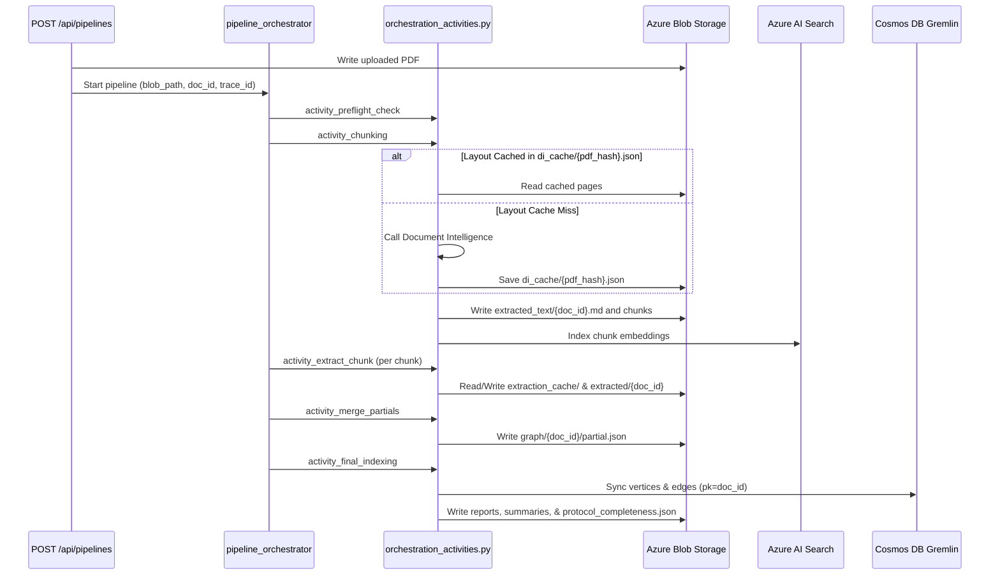

# Processing Module

`src/processing/` contains ingestion pipeline activities, document layout caching, vector indexing adapters, and cloud retrieval providers used by Azure Functions.

The Durable Orchestrators (`pipeline_orchestrator`, `completeness_verification_orchestrator`) are defined in `function_app.py`, while activity implementations live in this package.

## Responsibilities

- Parse raw PDFs using Azure AI Document Intelligence with content-hashed layout caching (`di_cache/`).
- Clean and normalize Hebrew right-to-left text and construct discrete chunks.
- Generate embeddings and index chunks in Azure AI Search.
- Run chunk-level graph extraction with persistent result caching (`extraction_cache/`).
- Merge partial graphs, resolve duplicate entities, and run community detection.
- Sync final graph vertices and edges to Cosmos DB Gremlin with `doc_id`/`pk` partitioning.
- Generate reports, community summaries, and protocol completeness artifacts.
- Preserve raw Markdown and chunk artifacts (`extracted/{doc_id}`) for fast text retrieval and re-chunking.
- Perform background protocol completeness verification using the query agent.

## Components

- `orchestration_activities.py`: Implementations of all Durable Function activities (`activity_preflight_check`, `activity_chunking`, `activity_extract_chunk`, `activity_merge_partials`, `activity_final_indexing`, `activity_cleanup_failed_run`, `activity_verify_protocol_completeness`).
- `document_processor.py`: PDF layout parsing via Document Intelligence, PyMuPDF fallback, Hebrew text normalization, and chunk generation.
- `vector_indexer.py`: Azure OpenAI embedding generation and Azure AI Search document upload.
- `cloud_knowledge_provider.py`: Retrieval provider for Azure AI Search (vector + keyword search) and Cosmos DB Gremlin (graph traversals, connections, timelines).
- `persistence_manager.py`: Coordinator for blob storage persistence.
- `strategies.py`: Pipeline strategy wrappers (DefaultEntityResolver, DefaultReporter).

## Pipeline Ingestion Flow

## Protocol Completeness Verification Activity

`activity_verify_protocol_completeness` runs on-demand when requested by `POST /api/cases/{docId}/completeness/verify`. It audits missing items by executing targeted searches via `QueryAgent` and updates `graph/{doc_id}/protocol_completeness.json` in Blob Storage.

## Maintainer Notes

- **Payload Sizes**: Activity inputs/outputs must remain small and JSON-serializable; claim-check patterns are used for chunks and graph JSONs.
- **Cache Preservation**: `di_cache/`, `extraction_cache/`, and `extracted/{doc_id}` are intentionally preserved across runs to prevent redundant Document Intelligence and Azure OpenAI LLM calls.
- **Trace Context**: `trace_id` must be passed through every activity parameter and logged with `[OBS]` prefixes.
