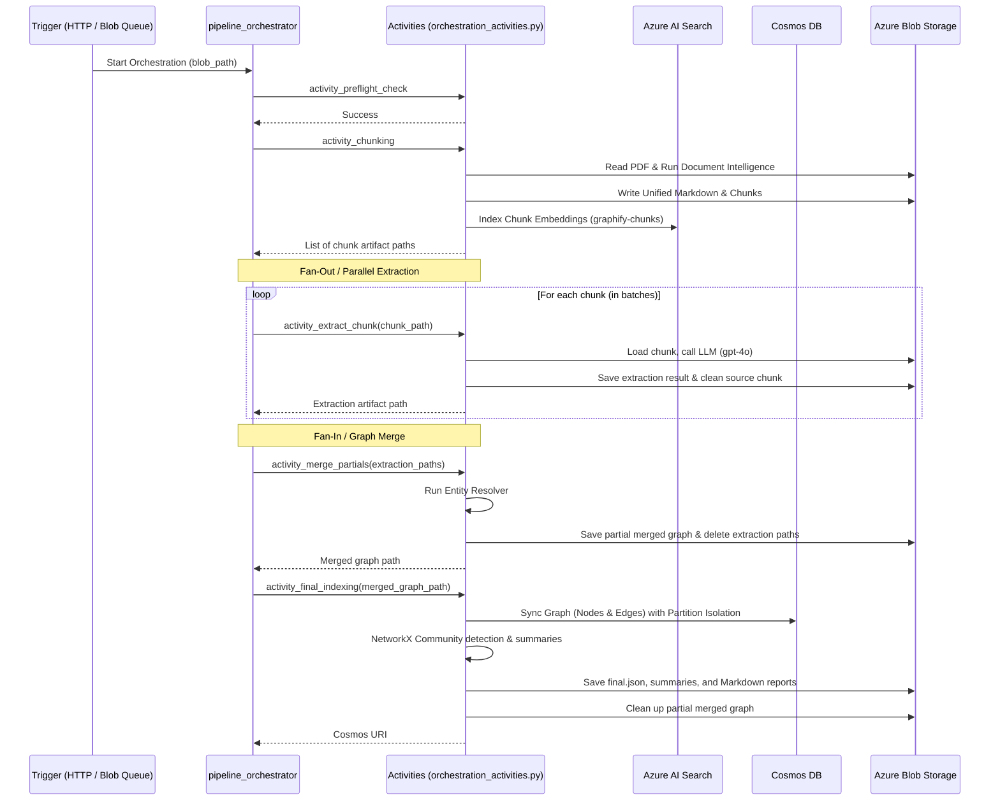

# Investigative Processing & Orchestration Module (`src/processing/`)

This module serves as the orchestrator of the ingestion pipeline. It coordinates the parsing, chunking, embedding generation, semantic indexing, and parallel graph building operations.

---

## 🌌 Orchestration Architecture (Map-Reduce & Durable Functions)

The processing pipeline is orchestrated via **Azure Durable Functions (Python V2 model)** inside `function_app.py`, calling activities implemented in `orchestration_activities.py`.

---

## ⚙️ Core Pipeline Components

### 1. Ingestion & Document Processing (`document_processor.py`)
- Ingests PDFs and Markdown files.
- Uses **Azure AI Document Intelligence** (`_load_document_pages_via_di`) for high-fidelity OCR, layout awareness, and text extraction.
- Detects and resolves **visual Hebrew (reversed layout)** anomalies to guarantee readable Hebrew chunks.
- Employs sentence-aware sliding window chunking to split files into clean text fragments.

### 2. Orchestration Activities (`orchestration_activities.py`)
Implements Durable Functions activities:
- **Preflight Check**: Verifies active connections to Azure Storage, Cosmos DB, and Azure Search.
- **Chunking**: Executes document parsing, generates sentence-based overlaps, indexes chunk text and vector embeddings in Azure Search, and uploads text chunks to Blob storage.
- **Chunk Extraction**: Triggers parallel extraction on each chunk using LLM strategies.
- **Merge Partials**: Runs entity resolution to unify nodes and edges.
- **Final Indexing**: Synces graph data to Cosmos DB, runs community summary algorithms, and generates report artifacts.

### 3. Semantic Vector Indexing (`vector_indexer.py`)
- Interfaces with Azure OpenAI to generate vector embeddings (using models like `text-embedding-3-small` or `text-embedding-ada-002`).
- Embeds chunk texts and indexes them in Azure AI Search.
- Note: Node/Edge vector search is disabled by design. Instead, semantic discovery is targeted purely at text chunks while graph logic is navigated via Cosmos Gremlin.

### 4. Cloud Knowledge Provider (`cloud_knowledge_provider.py`)
- Implements `KnowledgeProvider`.
- Exposes clean retrieval methods combining Azure AI Search and Cosmos DB.
- Enforces strict isolation: every query must pass a `doc_id` context as the partition key.

### 5. Dependency Verification (`dependency_checker.py` in `src/operations/`)
- Checks connectivity and operational status for Azure OpenAI, Cosmos DB Gremlin, Storage Account, Azure AI Search, and Document Intelligence.
