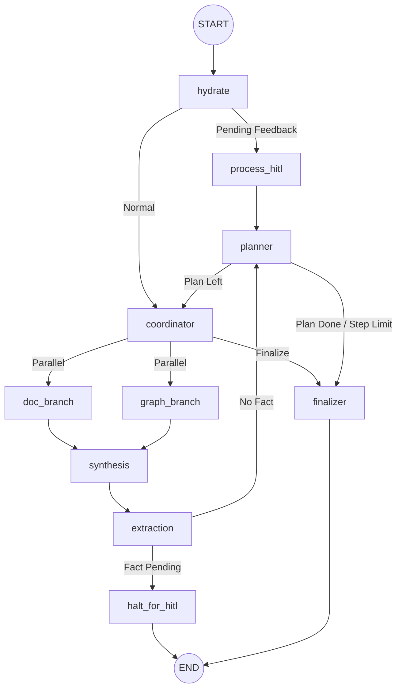

# Query Agent Module

`src/query_agent/` implements the investigative reasoning layer used by `POST /api/query` and background verification routines.

The query workload is Durable-orchestrated in `function_app.py`. The activity creates a stateless `QueryAgent`, executes an investigative state machine against the requested case (`doc_id`), and returns the final answer along with serialized conversation state.

## Responsibilities

- Answer Hebrew investigation questions strictly grounded in graph evidence and source document chunks.
- Enforce strict per-case partition isolation using `doc_id` across all Cosmos DB Gremlin queries and Azure AI Search retrieval calls.
- Execute dynamic routing across graph traversals, vector search, synthesis, and fact extraction using LangGraph `Command`.
- Support Human-In-The-Loop (HITL) fact ledger approvals (`VerifiedFact`, `PendingFactApproval`).
- Protect against infinite loops and recursion limits (`remaining_steps <= 2`).
- Emit structured `[OBS]` observability events correlated with `x-mag-trace-id`.

## State Machine Nodes & Dynamic Routing

The query agent uses a compiled LangGraph state machine (`src/query_agent/nodes.py`) with dynamic `Command(goto=...)` routing:

### Component Files

- `query_agent.py`: High-level `QueryAgent` class exposing the stateless `answer_question` API and tool definitions.
- `nodes.py`: Implementation of graph nodes (`hydrate_node`, `process_hitl_node`, `coordinator_node`, `doc_branch_node`, `graph_branch_node`, `synthesis_node`, `extraction_node`, `halt_for_hitl_node`, `planner_node`, `finalizer_node`).
- `state.py`: Pydantic state definitions (`InvestigationState`, `InvestigationInputState`, `InvestigationOutputState`, `VerifiedFact`, `PendingFactApproval`, `ChatMessage`, `AssistantMessage`).
- `ontology_engine.py`: Rules engine for ontology rule checks and Gremlin pushdown evaluation over Cosmos DB.
- `graph_query_builder.py`: Query builder helper for complex Gremlin traversals.

## Observability Events

- `query.started`
- `query.orchestrator_started`
- `query.langgraph.node.started`
- `query.langgraph.plan.created`
- `query.langgraph.route.selected`
- `query.langgraph.doc_search.executed`
- `query.langgraph.graph_action.selected`
- `query.langgraph.synthesis.completed`
- `query.langgraph.extraction.completed`
- `query.langgraph.hitl.pending`
- `query.langgraph.hitl.processed`
- `query.langgraph.finalized`
- `query.completed`
- `query.failed`

## Maintainer Notes

- **Partition Isolation**: Never execute un-partitioned graph or vector queries; `doc_id` MUST be passed to all retrieval methods.
- **Fact Ledger**: Final answers generated in `finalizer_node` must be strictly derived from `verified_facts` in state to prevent hallucination.
- **State Sanitization**: Intermediate transient search results (`transient_doc_results`, `transient_graph_results`) must be pruned before state is returned to the client to minimize payload size.
