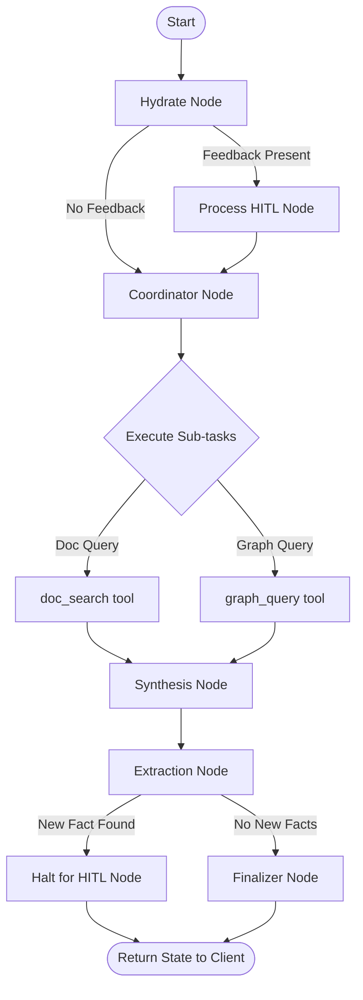

# Investigation Agent (`src/query_agent/`)

This module houses the orchestrator and reasoning layer of the MAG Agent. It implements a **Stateless LangGraph Pipeline** to verify, search, and synthesize evidence-backed legal answers while ensuring strict partition isolation, payload control, and mandatory human-in-the-loop (HITL) review.

---

## 🗺️ State-Passing Architecture

Unlike traditional stateful agents that require databases to hold conversation checkpointers, this agent is **stateless**. The entire graph state is serialized to JSON, returned to the client (e.g. CLI or Frontend API), and sent back to the server on the subsequent turn.

### The Ledger of Admissible Facts (`InvestigationState`)
The state structure is defined using Pydantic in [state.py](file:///home/lior/projects/MAG_Agent/src/query_agent/state.py):
- `doc_id`: Partition key of the current investigation case (mandatory for Cosmos DB isolation).
- `investigation_plan`: A scheduled list of sub-tasks built by the Planner/Coordinator.
- `verified_facts`: The official "Admissible Ledger" of facts confirmed by the user.
- `pending_fact_approval`: Stores facts discovered by the Extraction node awaiting user approval.
- `user_feedback`: Collects the user's action (Approved / Discarded / Edited) on the pending fact.
- `transient_*`: Temporary stores for parallel doc search, graph traversals, and synthesis results that are wiped before returning to the client.

---

## 🔁 LangGraph Execution Flow

The graph contains 10 nodes linked sequentially and conditionally:

### Key Execution Stages:
1. **Hydrate Node:** Validates the state schema and enforces **security ownership checks** (verifies that `doc_id` belongs to the current user's permitted cases).
2. **Process HITL Node:** If `user_feedback` is present, it processes the choice (writing the fact to `verified_facts` with full audit trace details or discarding it) and clears the pending state.
3. **Coordinator Node:** Deconstructs the user query into parallelizable sub-queries.
4. **Parallel Tools:** Runs high-performance database traversals (`graph_query`, `graph_timeline`, `check_ontology_rules`) and text index matching (`doc_search`).
5. **Synthesis Node:** Integrates the evidence from all branches.
6. **Extraction Node:** Identifies new facts, populates `pending_fact_approval` if any are found, and prunes transient retrieved data to prevent payload bloat.
7. **Halt for HITL Node:** Forces an interrupt before fact admission, returning the state payload to the client.
8. **Finalizer Node:** Formulates the final Hebrew response using **only** the approved facts in the ledger, then sanitizes the payload for the client.

---

## 🛠️ Specialized Programmatic Tools

To prevent LLM query confusion and Gremlin injection risks, dynamic Gremlin generation is deprecated in favor of structured Python tools in [query_agent.py](file:///home/lior/projects/MAG_Agent/src/query_agent/query_agent.py):
- **`graph_query`**: Traverses nodes and shortest paths inside Cosmos DB.
- **`graph_timeline`**: Extracts chronologically sorted event chains.
- **`check_ontology_rules`**: Runs the 7 pushdown legal logic rules directly inside Cosmos DB.
- **`doc_search`**: Performs hybrid semantic vector search against the Azure AI Search index.

All database tools programmatically inject the current `doc_id` as the partition key.

---

## 📂 Key Components

- **[query_agent.py](file:///home/lior/projects/MAG_Agent/src/query_agent/query_agent.py)**: Defines the outer agent runtime, specialized tools, and the interactive client-side chat loop.
- **[nodes.py](file:///home/lior/projects/MAG_Agent/src/query_agent/nodes.py)**: Implements all LangGraph execution nodes and compiles the graph structure.
- **[state.py](file:///home/lior/projects/MAG_Agent/src/query_agent/state.py)**: Defines the JSON-serializable `InvestigationState` models.
- **[ontology_engine.py](file:///home/lior/projects/MAG_Agent/src/query_agent/ontology_engine.py)**: Evaluates structural legal integrity constraints as optimized Cosmos DB pushdown queries.
