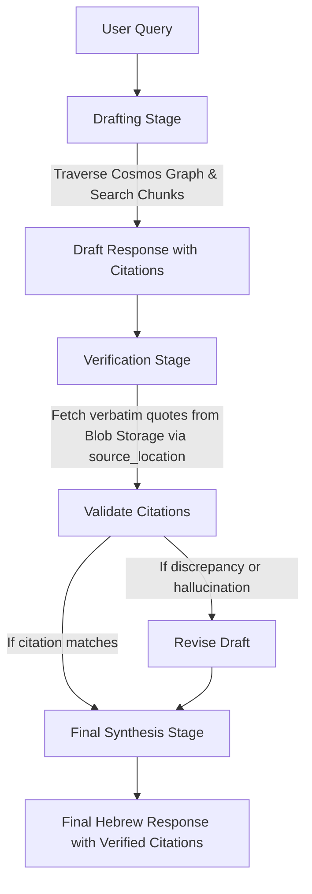

# Investigation Agent (`src/query_agent/`)

This module houses the reasoning layer that interacts with Azure Cosmos DB, Azure AI Search, and Azure Blob Storage to deliver synthesized, evidence-backed answers to complex investigative queries.

---

## 🔁 RARR Cycle (Reasoning, Action, Retrieval, and Revision)

To eliminate hallucinations and ensure extreme factual accuracy, the agent implements a three-stage **RARR cycle**:

1. **Drafting**: The agent reasons over the question and performs actions (e.g., shortest-path searches, semantic search) to create a draft answer containing citation anchors.
2. **Verification**: For every citation, the agent uses `search_original_document` to retrieve the original verbatim text chunk stored in Azure AI Search.
3. **Final Synthesis & Revision**: The agent compares the draft against the raw text. If any detail is unsupported or hallucinated, the draft is revised. The final output is rendered in Hebrew with verified sources.

---

## 🛠️ Specialized Investigative Toolset

The query agent is equipped with custom tools mapping directly to cloud resources:

- **`find_connections`**: Performs Gremlin path traversals in **Cosmos DB** (e.g., finding connections between Actor A and Actor B within `doc_id` partition).
- **`search_original_document`**: Executes semantic and vector searches against the **Azure AI Search** `graphify-chunks` index.
- **`search_semantic_actions`**: Employs vector embeddings to locate relationship labels and edges that are semantically close to an investigative behavior.
- **`get_central_actors`**: Evaluates degree centrality inside the Cosmos DB graph to pinpoint critical nodes ("God Nodes").
- **`global_graph_search`**: Scans community summary json artifacts in storage to resolve broad, thematic inquiries.
- **`build_timeline`**: Extracts date and event properties from Cosmos vertices/edges to construct a chronological order of events.
- **`find_isolated_entities`**: Traverses path hops starting from seed entities to find loosely connected or isolated actors.

---

## 🗺️ Map-Reduce Query Routing

For complex questions involving multiple events or actors (e.g. *"Compare the activities of X and Y"*), the agent invokes a Map-Reduce flow:
1. **Map Phase**: Breaks the main question into atomic sub-questions for each individual actor or event.
2. **Execution**: Queries the sub-questions in parallel using the standard toolset.
3. **Reduce Phase**: Pools all returned graph schemas and evidence text.
4. **Synthesis**: Generates a unified comparative answer with direct comparative citations.

---

## 📂 Key Components

- **`query_agent.py`**: The agent executor defining the tools, prompt templates, RARR cycle loop, and OpenAI orchestration.
- **`investigative_queries.py`**: Contains helper methods for executing Gremlin commands (pathfinders, central actor queries) via `CloudKnowledgeProvider`.
- **`ontology_engine.py`**: Validates agent thoughts and actions against the project legal ontology rules.
