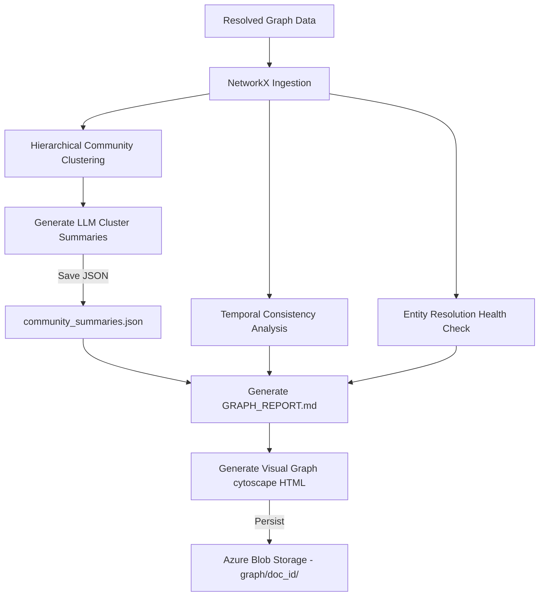

# Reporting & Community Summarization Module (`src/reporting/`)

This module transforms structured Knowledge Graph data into human-readable briefings, temporal timelines, topological summaries, and interactive graph visualizations.

---

## 📊 Reporting & Clustering Lifecycle

During the final stage of document ingestion (`activity_final_indexing`), the system performs the following analytical tasks:

### 1. Community Summarization
- Imports the resolved graph JSON into **NetworkX**.
- Run community detection algorithms (clustering and hierarchical mapping).
- Calls OpenAI (`gpt-4o`) to summarize each community's role and key activities, creating a `community_summaries.json` stored in the root and nested `doc_id` folders.

### 2. Forensic Report Generation
- **`GRAPH_REPORT.md`**: Implements standard templates showing:
  - High-level project stats (total nodes, edges, resolved aliases).
  - Central Actors list sorted by degree connectivity.
  - LLM community summaries.
  - Topological anomaly flags (e.g. temporal sequence issues, duplicate resolution health warnings).

### 3. Topological Anomaly Checks
- **Temporal Consistency**: Flags logic errors such as cause relationships occurring *after* effects by comparing event dates.
- **Resolution Health**: Detects potential human or organization entity duplicates that fall just below the merge thresholds, facilitating manual inspection.

---

## 📂 Key Components

- **`report_generator.py`**: Coordinates NetworkX graph construction, temporal evaluations, community summaries, and report compilation.
- **`local_graphify.py` (in `src/graph/`)**: Implements graph clustering and hierarchy parsing.
- **`persistence_manager.py` (in `src/processing/`)**: Ensures reports and visualizations are stored at correct paths in Azure Blob storage.
